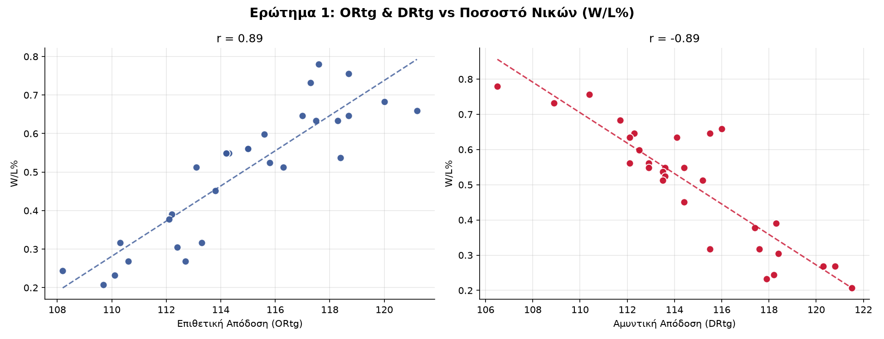
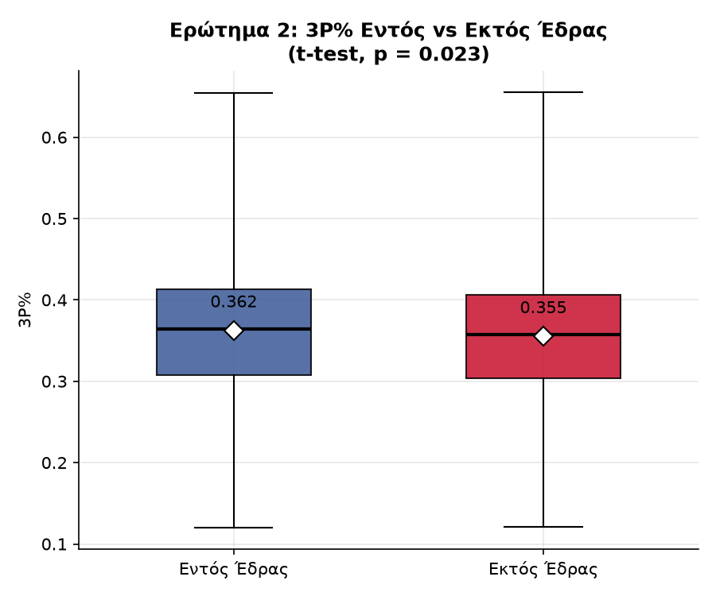
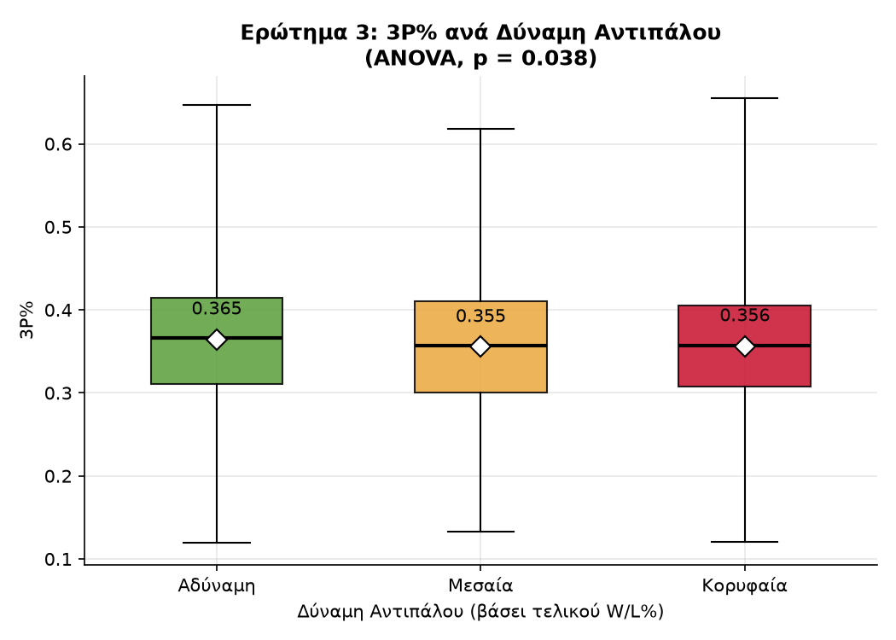

# 🏀 NBA 3PT Analysis — Do teams that shoot more 3-pointers win more games?

[🇬🇷 Ελληνικά](README.md) | 🇬🇧 English

  

> **TL;DR:** Shooting more three-pointers doesn't guarantee wins on its own — overall offensive and defensive rating (ORtg/DRtg) are the real deciding factors.

Statistical analysis of the relationship between 3-point shooting strategy and winning in the NBA, powered by a **live data pipeline** that pulls current stats directly from the official NBA API.

Started as a coursework project for a Statistics course (University of Crete) and evolved into an independent project with real, refreshable data.

## Research Questions

1. **Which factors most affect a team's performance?** (multiple regression, W/L% ~ ORtg, DRtg, Pace, TS%, 3PAr, 3P%)
2. **Does teams' 3P% differ between home and away games?** (t-test, game level)
3. **Does 3P% vary depending on opponent strength?** (ANOVA, game level)

## Findings

The results below are for the **2025-26 season** (full regular season). Reproduce them with `--season 2025-26` (see "How to run").

| Question | Result |
|---|---|
| 1. Key performance drivers | Backward elimination narrows it down to **ORtg**, **DRtg**, and **TS%** (p < 0.05, R² = 0.95) |
| 2. Home vs Away | Statistically significant difference (t-test, p = 0.023) — slightly better 3P% at home (36.2% vs 35.5%) |
| 3. Opponent strength | Statistically significant difference (ANOVA, p = 0.038) — better 3P% against weaker opponents |





## Project Structure

```
fetch_nba_data.py        # Pulls season-level team stats (ORtg, DRtg, Pace, 3PAr, 3P%, TS%)
analyze_regression.py    # Live regression + backward elimination for Question 1
analyze_game_level.py    # Pulls per-game data and runs Questions 2 & 3
nba_season.py            # Shared season logic (--season, warning when too few games)
make_plots.py            # Builds the three charts (q1_*.png, q2_*.png, q3_*.png)
NBAstats_live.csv        # Output of fetch_nba_data.py
NBA_gamelevel_live.csv   # Output of analyze_game_level.py
```

## How to run

```bash
pip install nba_api pandas scipy statsmodels matplotlib

python fetch_nba_data.py        # Run this first (current season, live)
python analyze_regression.py    # Question 1
python analyze_game_level.py    # Questions 2 & 3
python make_plots.py            # Charts
```

By default the pipeline pulls **live** data for the current season, which is calculated automatically from today's date. To use a specific season (e.g. to reproduce the findings above):

```bash
python fetch_nba_data.py --season 2025-26
```

The `analyze_*.py` scripts read the season from the CSV, so they automatically run on the same season. If the season has only just started (fewer than 20 games per team), the scripts print a warning that the results are not yet reliable.

## Methodological Notes & Limitations

- The original coursework examined Questions 2 and 3 at the **season** level (30 teams), using season-level 3P% and W/L% as a proxy. This version examines them correctly at the **game** level (2,400+ observations), which answers the question exactly as it was originally posed.
- The "opponent strength" categorization (Question 3) is based on the **final** season W/L% — meaning we know in hindsight which teams were strong, not their record at the time of the specific game. An acceptable simplification, but worth noting as a limitation.
- The **Age** (average roster age) and **SOS** (Strength of Schedule) variables from the original coursework were intentionally left out of the live pipeline: Age did not survive backward elimination in the original model (so removing it doesn't affect the conclusions), and SOS is not available through the official NBA API.
- The final model for Question 1 shows mild multicollinearity between ORtg and TS% (expected, since TS% contributes to the ORtg calculation) — the results are valid, but the individual coefficients should be interpreted with care.

## Data

Official NBA stats API (via [`nba_api`](https://github.com/swar/nba_api)), live, on demand.

## Tech Stack

Python, pandas, scipy, statsmodels, matplotlib, nba_api

---

The original statistical analysis (coursework) was carried out by Katholiki Skiada together with Christos Ieronymakis. The live data pipeline, the extension to game-level analysis, and the correction of Questions 2-3 were developed independently by Katholiki Skiada.

---

*Katholiki Skiada*
